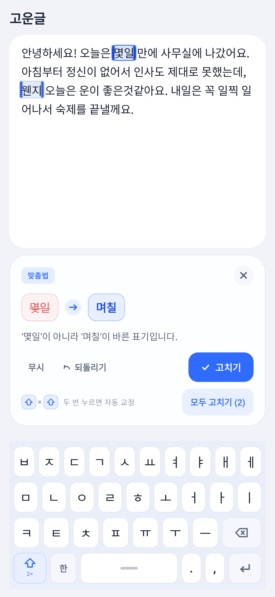
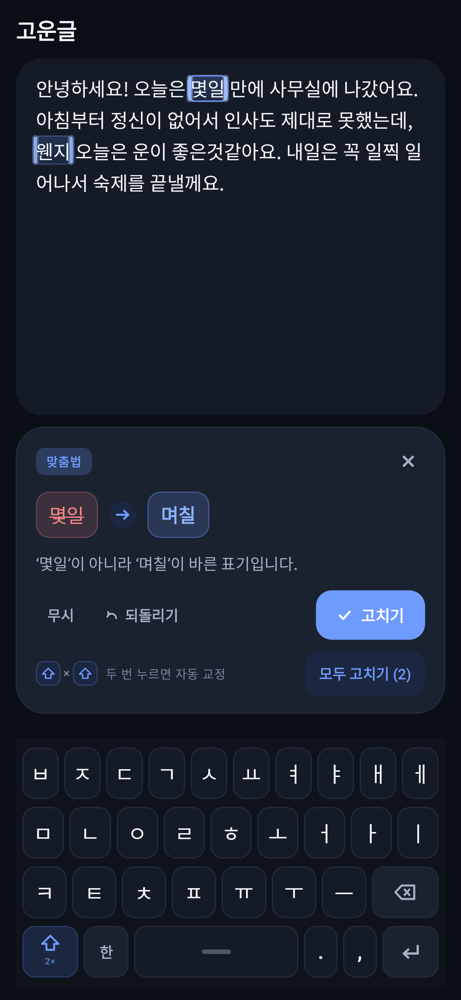

# 고운글 (Gounmal)

> 타이핑하는 순간, 맞춤법이 고쳐집니다.

<p align="center">
  
  
</p>

한국어 맞춤법을 **입력하는 동안 실시간으로** 잡아 주는 안드로이드 앱입니다.
오류 구간은 iOS 선택 영역처럼 부드러운 반투명 파란 하이라이트로 감싸지고,
바로 아래 카드에서 무엇이 틀렸는지 · 어떻게 고치면 되는지 보여 줍니다.
**⇧(Shift)를 두 번** 누르면 그 자리에서 한 번에 교정됩니다.

---

## 1. 바로 써 보기 (설정 없음)

1. 저장소의 **Actions → Android CI → 최신 실행 → Artifacts** 에서 `gounmal-apk` 를 내려받습니다.
   (태그 `v*` 로 푸시하면 **Releases** 에도 APK 가 올라갑니다.)
2. APK 를 설치합니다. (안드로이드가 "출처를 알 수 없는 앱" 확인을 요청하면 허용)
3. 앱을 실행하면 **계정 · API 키 · 사전 설정 없이** 바로 타이핑할 수 있습니다.

- 최소 지원: **Android 7.0 (API 24)**
- 앱 안에 한글 자모 키보드가 들어 있어 시스템 키보드 설정을 건드릴 필요가 없습니다.

## 2. 주요 기능

| 기능 | 설명 |
| --- | --- |
| 실시간 검사 | 입력이 멈추면(약 0.24초) 즉시 오프라인 검사, 이어서 온라인 정밀 검사 |
| 하이라이트 | 오류 구간을 반투명 파란색 + 둥근 모서리로 감싸고, **양 끝에 짙은 파란 커서 손잡이** |
| 교정 카드 | 원문 → 대치어, 다른 후보, 설명, `고치기` / `무시` / `모두 고치기` / `되돌리기` |
| ⇧ 두 번 | 화면의 모든 오류를 **한 번에** 교정 (하드웨어 Shift 키도 동일하게 동작) |
| ⇧ 한 번 | 다음 오류로 이동 (두 번과 구분하기 위해 0.4초 뒤 실행) |
| 교정 직후 | 고친 구간이 0.85초 동안 부드럽게 반짝이고, 상단 알림에서 바로 되돌리기 가능 |
| 앱 내 키보드 | 한글 자모 조합(복합 모음/받침, 종성 넘김) + 영문 전환 + ⇧ · ⌫ · ↵ |
| 정밀 검사 토글 | 상단 `정밀` 배지를 눌러 온라인 검사 on/off. 꺼도 오프라인 검사는 계속 |

## 3. 디자인

- **하이라이트**: 세로 그라디언트(위가 조금 더 진함), 모서리 6dp 라운드, 텍스트 위아래 1.5dp 여유.
- **커서 손잡이**: 하이라이트 양 끝에 폭 3dp 의 둥근 막대 + 옅은 번짐(glow).
- **카드**: 26dp 라운드, 파란색 기운의 부드러운 그림자, 반투명 파란 배지/칩.
- **모션**: 카드는 아래에서 살짝 올라오며 페이드 인, 키는 눌릴 때 0.94배로 스프링 축소.
- **다크 모드**: 자동 대응. 하이라이트는 채도를 높이고 배경은 저채도 네이비.

| 토큰 | 라이트 | 다크 |
| --- | --- | --- |
| 하이라이트 채움(상) | `#3B7BFF` 20% | `#6E9BFF` 24% |
| 하이라이트 테두리 | `#2F6BFF` 30% | `#749EFF` 60% |
| 커서 | `#1547D8` | `#9DBCFF` |
| 강조색 | `#2F6BFF` | `#6E9BFF` |
| 배경 | `#F1F3F9` | `#0A0E15` |

## 4. 동작 방식

### 4-1. 오프라인 엔진 (`OfflineSpeller`)

네트워크 없이 즉시 동작하며, **확신할 수 있는 것만** 고칩니다. (잘못 고치는 것보다 안 고치는 편이 낫다는 원칙)

- **오탈자 사전**: 됬→됐, 되요→돼요, 안되요→안 돼요, 몇일→며칠, 웬지→왠지, 할께→할게, 역활→역할 …
- **띄어쓰기**: 앞 음절의 받침이 `ㄹ` 일 때만 의존 명사를 확신합니다.
  - `할수있다 → 할 수 있다`, `그럴줄알았다 → 그럴 줄 알았다`, `할거야 → 할 거야`
  - `한개 → 한 개`, `3명 → 3 명`
- **문장 부호**: `안녕하세요!오늘은 → 안녕하세요! 오늘은`, `네 . → 네.` (소수점 `3.14`, 도메인 `a.b` 는 건드리지 않음)

### 4-2. 온라인 정밀 검사 (`OnlineSpeller`)

- 공개된 한국어 맞춤법/문법 검사기 웹 페이지에 `text1` 로 POST 하고, 응답 HTML 의 `data = [...]` JSON 을 읽습니다.
  API 키나 계정이 필요 없습니다.
- 텍스트를 **줄 단위로 220자 이하로 잘라** 보내고, 응답의 `start`/`end` 에 잘린 위치를 더해 **원문 좌표로 되돌립니다**.
- 실패(오프라인·형식 변경·시간 초과)하면 조용히 실패하고 오프라인 결과만 남깁니다. 카드에 "온라인 검사에 연결하지 못했어요" + `다시 시도` 가 표시됩니다.
- 오프라인에서 이미 잡은 구간과 겹치는 온라인 결과는 버립니다(중복 하이라이트 방지).

### 4-3. 자동 교정 흐름

```
타이핑 → HangulComposer(자모 합치기) → ViewModel
      → (디바운스) OfflineSpeller → UI 하이라이트
      → (0.9초 뒤) OnlineSpeller → 결과 병합(겹치면 오프라인 우선)
⇧ ⇧    → applyAllIssues() → 겹치지 않는 편집 목록 → Edits.apply() → 커서 보정 → 되돌리기 스냅샷
```

## 5. 빌드

```bash
# JDK 17 + Android SDK 만 있으면 됩니다. (Gradle 은 wrapper 가 알아서 받습니다)
./gradlew assembleRelease      # app/build/outputs/apk/release/app-release.apk
./gradlew testDebugUnitTest    # 단위 테스트
```

- **GitHub Actions**: `main`, `arena/**`, PR, 수동 실행 시 자동으로 테스트 + APK 빌드. 태그 `v*` 는 릴리스에 APK 첨부.
- **서명**: `keystore.properties` 가 없으면 **디버그 키로 서명**해서 그대로 설치할 수 있는 APK 가 나옵니다.
  스토어 배포용으로는 다음 4개 값을 담은 `keystore.properties` 를 두거나, CI secrets
  (`KEYSTORE_BASE64`, `KEYSTORE_PASSWORD`, `KEY_ALIAS`, `KEY_PASSWORD`)를 등록하면 그 키로 서명합니다.

```properties
storeFile=keystore.jks
storePassword=******
keyAlias=gounmal
keyPassword=******
```

## 6. 프로젝트 구조

```
app/src/main/java/com/arena/gounmal/
├─ MainActivity.kt
├─ EditorViewModel.kt          # 편집 상태 · 디바운스 검사 · 교정/되돌리기 · ⇧ 두 번
├─ input/
│  ├─ HangulComposer.kt        # 순수 Kotlin 한글 자모 조합기 (JVM 테스트 가능)
│  └─ ShiftDoubleTapDetector.kt
├─ spell/
│  ├─ Models.kt                # Issue / Edit / Edits.apply / TextDiff
│  ├─ OfflineSpeller.kt        # 즉시 동작하는 규칙 기반 교정
│  └─ OnlineSpeller.kt         # 온라인 정밀 검사 + 응답 파서
└─ ui/
   ├─ HighlightEditor.kt       # 하이라이트 · 양 끝 커서 · 반짝 효과
   ├─ SuggestionCard.kt        # 교정 내용 박스
   ├─ GounmalKeyboard.kt       # 앱 내 한글 키보드 (⇧ 포함)
   ├─ EditorScreen.kt          # 화면 조립 · 헤더 · 알림
   ├─ Icons.kt                 # 직접 그린 아이콘
   └─ theme/Theme.kt
```

## 7. 테스트

`app/src/test` 에 순수 JVM 테스트가 있습니다.

- `HangulComposerTest` — 가나/과/관/값/뷁, 종성 넘김, 백스페이스, 선택 영역 대체
- `OfflineSpellerTest` — 오탈자·띄어쓰기·문장부호, 오탐 방지(소수점·별수없이), 교정 후 재검사
- `EditsTest` — 다중 편집/커서 보정/겹침 제거/되돌리기 diff
- `ShiftDoubleTapDetectorTest` — 0.4초 창, 세 번째 누름 처리
- `PusanResponseParserTest` — 응답 파싱, 문자열 속 괄호, offset 재매핑

## 8. 스크린샷

`docs/screenshots` 의 이미지는 `ScreenshotTest` 가 실제 컴포저블을 렌더링해 만든 것입니다.
push 될 때마다 CI 가 다시 그려 커밋하므로, UI 를 고치면 스크린샷도 자동으로 최신 상태가 됩니다.

```bash
./gradlew testDebugUnitTest --tests "*ScreenshotTest*"
# 결과: app/build/screenshots/screen-light.png, screen-dark.png
```

## 9. 알려진 한계

- 오프라인 엔진은 **보수적**입니다. 사전에 없는 단어를 추측해서 고치지 않으므로, 잡지 못하는 오류도 있습니다.
  (정밀 검사 토글을 켜면 더 많이 잡힙니다.)
- 온라인 정밀 검사는 외부 공개 웹 페이지를 이용하므로, 그쪽 형식이 바뀌면 동작하지 않을 수 있습니다.
  이때도 앱은 오프라인 모드로 정상 동작합니다.
- 한국어 텍스트만 대상으로 합니다.
